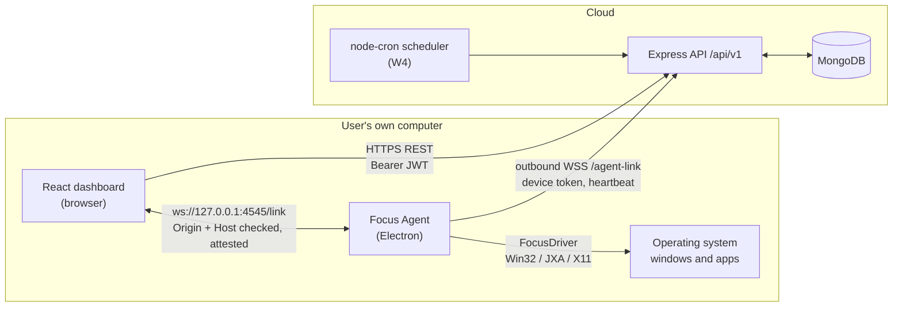

# Focus Mode — Distraction Lockdown Dashboard

> A MERN dashboard plus a locally installed Electron **Focus Agent**. You log in to the React dashboard, pair the Focus Agent on **your own computer**, then start a timed focus session. The Focus Agent moves your other foreground applications aside while the browser (and the apps you allow-listed) stay available; ending the session — from the dashboard, from the agent's tray, on timer expiry, or after a crash — fully restores normal use. The web page never touches the OS: it talks to the Focus Agent over a consent-driven loopback channel, and the OS work stays behind one small interface.

### What this is, in one paragraph

Distractions are foreground windows: games, chat, unrelated browsers. A website cannot reach them, so a dashboard alone cannot create a focus state. Focus Mode splits the problem across three cooperating parts — a React dashboard, an Express + MongoDB API, and an Electron Focus Agent that is the **only** component allowed to touch the operating system. The dashboard and API carry the product (accounts, devices, sessions, schedules, analytics); the Focus Agent carries the trust boundary (pairing, local-link authentication, window handling, journal-backed restore). Every action is explicit, consented, visible and reversible.

**Build status:** W0–W4 gates have passed and **W5 is in progress** (insights, settings, admin, landing, notifications). Everything through the focus core, schedules, and the dashboard's device / allow-list / session flows is merged and tested; the feature table below states exactly what is verified, what is partially verified (naming what remains a human check), and what is planned — nothing more. Task-level evidence lives in [`docs/AGENT_STATUS.md`](docs/AGENT_STATUS.md) and per-platform detail in [`docs/PLATFORMS.md`](docs/PLATFORMS.md).

---

## Contents

1. [Architecture](#1-architecture)
2. [Feature status by PDF ID](#2-feature-status-by-pdf-id)
3. [Tech stack](#3-tech-stack)
4. [Repository layout](#4-repository-layout)
5. [Local setup](#5-local-setup)
6. [Test credentials](#6-test-credentials)
7. [Pairing and first focus: walkthrough](#7-pairing-and-first-focus-walkthrough)
8. [Installing the Focus Agent](#8-installing-the-focus-agent)
9. [Privacy and safety](#9-privacy-and-safety)
10. [Known limitations](#10-known-limitations)
11. [Documentation](#11-documentation)

---

## 1. Architecture



**The boundary, and why it exists.** Browser JavaScript deliberately cannot enumerate or move other applications, so the dashboard cannot enforce anything by itself. The bridge is a WebSocket that the dashboard opens to the Focus Agent on loopback (`127.0.0.1`, ports 4545–4549). The agent binds loopback only and rejects upgrades whose `Origin` is not allow-listed and whose `Host` is not the local host (DNS-rebinding defence). Being reachable is not enough to be trusted: control messages (`enterFocus`, `exitFocus`) additionally require a **60-second, nonce-bound Ed25519 attestation** that the API signs for the logged-in user **and** the paired device, so a hostile page that reaches the port still cannot start a session. The 6-digit pairing code exists only in the agent window and never travels over the loopback channel or the wire. Everything OS-specific lives behind one interface — `enterFocus(allowList) / exitFocus() / getState()` — with a per-OS `FocusDriver` implementation, so neither the dashboard nor the API contains platform code.

**Invariants** (the rules the code and tests are written against):

| # | Invariant |
|---|---|
| INV-1 | Only the Focus Agent touches the OS. The dashboard and the cloud API never issue OS commands. |
| INV-2 | The cloud can send the agent only `scheduleDue` and `revoked` — never `enterFocus` or any other control message. |
| INV-3 | The protected set (browsers, the agent itself, OS-critical processes) can never be removed or touched. |
| INV-4 | The restore journal is written **before** focus is applied, so a crash cannot leave the desktop stuck. |
| INV-5 | Exit/restore is idempotent and always reachable from the agent UI — including with the dashboard closed. |
| INV-6 | No component reads or transmits window titles, URLs, page contents or keystrokes. |

## 2. Feature status by PDF ID

Status legend (as of the W4 gate; W5 is in progress — evidence in `docs/AGENT_STATUS.md` and `docs/PLATFORMS.md`):

- ✅ **Implemented and verified** — merged to `main`, covered by passing automated tests and/or a real end-to-end or manual evidence run recorded at a wave gate.
- 🟡 **Partially verified** — implemented and tested, but a named part of the acceptance criteria is still NEEDS-HUMAN (each row says which part).
- 🔄 **In progress** — being built in the current wave (W5); not claimed as working.
- 📋 **Planned** — scheduled for a later wave; not implemented yet.

At the W4 gate (2026-11-11) the repository had **1015 unit/integration tests green** (shared 175 · server 220 · client 125 · agent 495) and a **Playwright E2E suite of 16 passing tests + 1 self-gated skip** (the missed-run E2E re-arms automatically once the W5 notifications API lands). The E2E suite drives the real dashboard, the real API with a seeded in-memory MongoDB, and the real Electron Focus Agent; `scripts/verify/macos-focus-smoke.ts` additionally proves real window hide/restore on macOS (DEC-020).

| PDF ID | Feature | Pri | Status | Evidence / next step |
|---|---|---|---|---|
| AUTH-1 | Signup, login, logout, JWT, protected routes, seeded admin | P0 | ✅ Implemented and verified | W1 gate: server auth integration tests (401/403/429, bcrypt cost 12, no password hash in responses); the real E2E logs in through the API; CI green on Ubuntu, Windows and macOS |
| FR-030 | Idempotent demo seed (admin, demo user, ≥30 days of history, schedules, presets, agent links) | P0 | ✅ Implemented and verified | W1 gate: seed idempotency tests; the same seed powers the E2E API |
| PAIR-1 | 6-digit code pairing; connected/disconnected status | P0 | ✅ Implemented and verified | W2 gate: real E2E — real Electron agent → real 6-digit code → `POST /devices/pair` → Connected badge via a real Ed25519 attestation. KI-010 (badge refresh) was fixed and re-verified at the W4 gate: pair/unpair now update the badge with no reload |
| LINK-1 | Loopback WebSocket with live status both ways | P0 | ✅ Implemented and verified | W2/W4: link integration tests + real E2E over `ws://127.0.0.1`; foreign Origin/Host rejected; attested handshake and live state transitions covered |
| AGENT-1 | Runnable Electron Focus Agent with tray/menu-bar presence and Quit | P0 | 🟡 Partially verified | Real Electron agent launches, pairs, shows its window and reports state in the E2E; `AGENT_SMOKE` launcher passes in CI on all OSes. Native tray/notification visuals are NEEDS-HUMAN (KI-013, T-101) |
| FOCUS-1 | Start focus → other foreground apps step aside, browsers stay | P0 | ✅ Implemented and verified | W3: FakeDriver focus E2E (Start → consent → countdown → End → restore) plus **real macOS** verification — `scripts/verify/macos-focus-smoke.ts` hides and restores TextEdit through the real Darwin driver (`PASS darwin/arm64`). Windows/Linux runtime is NEEDS-HUMAN (see X-PLAT-1) |
| FOCUS-2 | End focus → full restore from dashboard or agent tray | P0 | ✅ Implemented and verified | W3: journal-first idempotent restore covered by controller tests + focus E2E; the real macOS restore is verified by the same script |
| FOCUS-3 | Timed 25/50/60/custom sessions, live countdown, auto-end | P0 | ✅ Implemented and verified | W3: countdown derived from the agent's absolute `endsAt` in the E2E; timer/auto-end/sleep accounting covered by agent unit tests |
| SAFE-1 | Protected allow-list never removable; user-added apps | P0 | ✅ Implemented and verified | W3/W4: protected-set matcher property tests + allow-list API tests rejecting protected changes (`PROTECTED_ENTRY` on 4 attack shapes) + E2E; the UI shows locked protected rows |
| SAFE-2 | Explicit pre-session confirmation; always-visible focus indicator | P0 | ✅ Implemented and verified | W3: the consent modal cannot send `enterFocus` before Confirm (tested), and the global indicator is on every authenticated route; the native first-run consent gate is E2E-covered through a test seam (KI-011), its visuals are unit-tested only |
| SESS-1 | Session history (start/end, planned and actual minutes, completed vs cancelled) | P0 | ✅ Implemented and verified | W3/W4: sessions API tests (idempotency, 409, filters) + E2E `api-sessions` / `session-reporting` including dashboard-closed reporting; dashboard history cards are live |
| X-PLAT-1 | Windows and macOS behind one agent interface | P1 | 🟡 Partially verified | macOS real verified (DEC-020). Windows (koffi) and Linux X11 (`wmctrl`/`xdotool`) are implemented behind the frozen `FocusDriver`, covered by mocked-native contract tests and CI builds; real window control on those OSes is NEEDS-HUMAN (KI-005, T-100/T-102) |
| SCHED-1 | Recurring schedules auto-start when the agent is running | P1 | ✅ Implemented and verified | W4: real-scheduler E2E — create schedule → minute tick → `scheduleDue` → ≥10 s cancellable heads-up → source SCHEDULE session → run recorded and persisted; the offline MISSED path is covered by server tests (missed-run E2E self-gated until the W5 notifications API) |
| RECONN-1 | Graceful disconnect, reconnect and sleep handling | P1 | 🟡 Partially verified | W2 shipped link reconnect/backoff + heartbeat; W3 covered sleep/resume reconcile and crash recovery in the controller. Full cross-layer hardening (T-080) is W6 |
| ANALYTICS-1 | Totals, daily/weekly chart, streaks, completion rate | P1 | 🔄 In progress | W5: insights API + `/insights` page are landing in this wave |
| FR-019 | Admin: users, presets, agent links, aggregate stats | P0 | 🔄 In progress | W5: admin APIs + `/admin` page are landing; the route already enforces the ADMIN role guard |
| FR-021 | All dashboard pages, profile/password, notifications, badge, focus indicator | P0 | 🟡 Partially verified | All 13 routes render with role guards; dashboard, devices, allow-list, schedules and focus are real. `/insights`, `/settings`, `/admin`, the landing page and the notifications bell land in W5 |
| FR-025 | Missed scheduled runs recorded and notified | P1 | 🟡 Partially verified | Missed runs are recorded and notified server-side (scheduler/reaper tests); the notifications REST/UI surface and the missed-run E2E land in W5 |
| FR-029 | Profile, change password, notifications, unpair all, download agent | P0 | 🔄 In progress | W5: `/settings` + `/users/me` APIs are landing |
| BLOCK-1 | Optional browser block-list during focus | P2 | 📋 Planned | W10 bonus (requires an optional MV3 browser extension) |
| POMO-1 | Pomodoro cycles + ambient sounds | P2 | 📋 Planned | W10 bonus |
| MULTI-1 | Multiple paired devices, choose which to focus | P2 | 📋 Planned | W10 bonus |
| GAMIFY-1 | Badges, leaderboards, goals | P2 | 📋 Planned | W10 bonus |

## 3. Tech stack

| Layer | Choice |
|---|---|
| Language | TypeScript 5.9.3 (`strict`, ESM) across all packages; Node.js 22+ |
| Dashboard (`client/`) | React 19 + Vite 8, React Router 7, Tailwind CSS 4, TanStack Query, react-hook-form + zod, Recharts, motion; typed `fetch` transport (one dependency fewer) |
| API (`server/`) | Express 5, Mongoose 9 / MongoDB, zod 4, bcryptjs (cost 12), jsonwebtoken (HS256, 30 min), `ws` for the agent link, node-cron, pino |
| Focus Agent (`agent/`) | Electron 45, TypeScript main process + tiny renderer, `ws`, `safeStorage` for the device token, electron-log; `koffi` (Win32 FFI), `osascript`/JXA (macOS), `wmctrl`/`xdotool` (Linux X11) |
| Packaging / CI | electron-builder (NSIS + portable, dmg + zip, AppImage + deb); GitHub Actions matrix on Ubuntu, Windows and macOS with gitleaks + CodeQL |
| Tests | Vitest (unit + API integration), supertest, mongodb-memory-server, Playwright (dashboard E2E and real `_electron` agent), axe-core |

No AI/ML module is part of this project, and no telemetry or analytics SDK is included.

## 4. Repository layout

```
focus-mode/
├── shared/    Protocol messages, zod schemas, error codes, protected-app set — the one contract imported by both clients and the server
├── server/    Express 5 + Mongoose API, /agent-link WebSocket hub, scheduler, seed script, integration tests
├── client/    React dashboard: all routes, role guards, AgentLink provider, live agent status
├── agent/     Electron Focus Agent: tray/window UI, loopback link, cloud client, journal, per-OS FocusDriver
├── e2e/       Playwright E2E: real dashboard + real API (in-memory MongoDB, seeded) + real Electron agent
├── docs/      Decisions, contracts, traceability, platform matrix, UX spec, known issues, release guide
└── .github/   CI matrix + release workflow (all third-party actions SHA-pinned)
```

`shared/` is the only package every other package imports; its protocol and REST schemas are frozen (tag `contracts-v1`) and any change requires an ADR in [`docs/DECISIONS.md`](docs/DECISIONS.md).

## 5. Local setup

### Prerequisites

| Requirement | Notes |
|---|---|
| Node.js **22.12+** and npm **9+** | CI uses Node 22; development here used Node 26.11.1 |
| A MongoDB server | A local `mongod` or a MongoDB Atlas connection string. Tests and E2E do **not** need one (they use `mongodb-memory-server`) |
| `openssl` | To generate the JWT/pepper secrets and the Ed25519 attestation keypair |
| A desktop session for the Focus Agent | Electron needs a display. macOS, Windows, or Linux with X11 |

### 1. Install dependencies

```sh
git clone https://github.com/klrajput/Focus-Mode.git
cd Focus-Mode
npm install
npm run build -w @focus-mode/shared   # one-time (also run automatically by `npm run dev`): other packages import its compiled output
```

### 2. Copy the environment examples

Each package ships a commented `.env.example`; copy all three (`.env` files are gitignored and must never be committed):

```sh
cp server/.env.example server/.env
cp client/.env.example client/.env
cp agent/.env.example agent/.env
```

### 3. Configure the server secrets

Edit `server/.env` and point `MONGO_URI` at your MongoDB. Then generate the real secrets — the shipped values are `CHANGE_ME_*` placeholders:

```sh
# JWT_SECRET (SEC-2) and PAIR_PEPPER (SEC-5) — run twice, paste each output into server/.env
openssl rand -base64 48

# Ed25519 keypair for the 60 s, nonce-bound local-link attestation (SEC-7)
openssl genpkey -algorithm ED25519 -out attest-private.pem
openssl pkey -in attest-private.pem -pubout -out attest-public.pem
```

`ATTEST_PRIVATE_KEY` / `ATTEST_PUBLIC_KEY` must each be **one double-quoted line** with literal `\n` between PEM lines (dotenv expands them). Print the exact value to paste:

```sh
node -e 'const fs=require("node:fs");process.stdout.write(fs.readFileSync("attest-private.pem","utf8").trim().replace(/\n/g,"\\n"))'
node -e 'const fs=require("node:fs");process.stdout.write(fs.readFileSync("attest-public.pem","utf8").trim().replace(/\n/g,"\\n"))'
```

The server boots in development with the shipped placeholder values, but **they are public placeholders — replace them**. With the placeholder pepper, pairing appears to work but is insecure (the pepper is known); with the placeholder attestation key the local-link attestation cannot sign, so the dashboard badge cannot authenticate — paste a real Ed25519 keypair for the full flow. In production all three secrets are mandatory: the server refuses to boot without them. The API exposes the public key at `GET /api/v1/agent/attest-key`, so the Focus Agent never holds a private key.

`client/.env` already points at `http://localhost:5000/api/v1`, and `agent/.env` at the same API plus `AGENT_ALLOWED_ORIGINS=http://localhost:5173` — adjust them if you change ports or hosts.

### 4. Seed the demo data

```sh
npm run seed        # root alias for `npm run seed --workspace @focus-mode/server`
```

The seed is idempotent (safe to run twice) and refuses `NODE_ENV=production` without `--force`. It prints the demo logins listed in [Test credentials](#6-test-credentials).

### 5. Start everything

```sh
npm run dev
```

This runs, in parallel: the API on `http://localhost:5000`, the dashboard on `http://localhost:5173`, and the Focus Agent (builds `agent/dist` then launches Electron). To run pieces separately:

```sh
npm run dev --workspace @focus-mode/server
npm run dev --workspace @focus-mode/client
npm run dev --workspace @focus-mode/agent     # builds + launches the Electron agent
```

Open `http://localhost:5173` and log in with the demo account. The Focus Agent opened a window with its 6-digit pairing code; see the [walkthrough](#7-pairing-and-first-focus-walkthrough).

### 6. Run the tests

```sh
npm run lint
npm run typecheck
npm test          # 1015 unit/integration tests at the W4 gate; the server suite downloads a MongoDB binary on first run
npm run build
```

End-to-end tests drive the **real** dashboard, API and Electron Focus Agent (no mocks for backend, DB or agent). They need the shared and agent packages built, Playwright's Chromium, and a display (headless Linux: `xvfb-run`):

```sh
npm run build -w @focus-mode/shared
npm run build -w @focus-mode/agent
npx playwright install chromium
npx playwright test
```

On a machine where the user cache is not writable (sandboxed dev machines, KI-007) keep the browser and its cache inside the workspace:

```sh
PLAYWRIGHT_BROWSERS_PATH=$PWD/.playwright-browsers npx playwright install chromium
PLAYWRIGHT_BROWSERS_PATH=$PWD/.playwright-browsers npx playwright test
```

Two extra verification tools:

```sh
node scripts/smoke/launch.mjs                  # headless AGENT_SMOKE boot of the built agent (same check the release workflow runs)
npx tsx scripts/verify/macos-focus-smoke.ts    # macOS only: real hide/restore of TextEdit through the real Darwin driver (FOCUS-1/FOCUS-2)
```

## 6. Test credentials

Seeded by `npm run seed` for the exam walkthrough (demo values only — never reuse them on a real deployment):

| Role | Email | Password |
|---|---|---|
| ADMIN | `admin@demo.com` | `Admin@123` |
| USER (persona "Kabir") | `kabir@demo.com` | `Kabir@123` |

The seed also includes ≥30 days of realistic session history, schedules, allow-list presets and agent-download links so the dashboard has data to show.

## 7. Pairing and first focus walkthrough

1. **Start the stack** with `npm run dev` (or run the agent separately with `npm run dev --workspace @focus-mode/agent`).
2. **Run the Focus Agent** — its window shows a state and, while unpaired, a **6-digit pairing code**. The code exists only in the agent window; it is never sent to the dashboard (a web page that can reach `127.0.0.1` must not be able to read it).
3. **Log in** at `http://localhost:5173/login` as `kabir@demo.com` / `Kabir@123`.
4. **Pair the agent** — open `/devices`, choose *Pair a device*, type the 6-digit code, confirm. The dashboard calls `POST /api/v1/devices/pair`; the agent polls for its device token (delivered once, never through the browser), switches to `PAIRED`, and the dashboard badge shows **Connected** through the attested local link, with no page reload needed (KI-010 fixed and verified at the W4 gate).
5. **Review the allow-list** — `/allowlist` keeps browsers, the Focus Agent itself and OS-critical processes permanently locked; your own apps can be added.
6. **Start a session** — on `/dashboard` pick 25 / 50 / 60 minutes or a custom duration, read the consent dialog (what stays open, what steps aside, how to end), and confirm. The dashboard sends `enterFocus` over the local link; the Focus Agent writes its journal first and then moves other foreground apps aside.
7. **Watch the session** — `/focus` shows a countdown derived from the agent's absolute `endsAt`; a global focus indicator stays visible on every authenticated page, and the agent's tray always offers *End focus*.
8. **End and restore** — finish from the dashboard, from the agent tray, on timer expiry, or by quitting the agent. Windows the agent changed are restored; windows you had already minimised stay minimised; the session is finalised once and appears in history.

> All eight steps are implemented on the merged product. Real window movement is verified on **macOS arm64** (`scripts/verify/macos-focus-smoke.ts`) and against the FakeDriver in the E2E suite; Windows and Linux X11 runtime behaviour is NEEDS-HUMAN, and native tray/notification visuals remain a manual check (KI-013). Platform details: [`docs/PLATFORMS.md`](docs/PLATFORMS.md).

## 8. Installing the Focus Agent

Prebuilt installers are produced by [`.github/workflows/release.yml`](.github/workflows/release.yml) on the project's native GitHub runners: Windows NSIS `.exe` + portable, macOS `.dmg`/`.zip` (arm64 and x64), Linux AppImage and `.deb`. **Real unsigned installers have already been built by CI**: workflow-dispatch run `42858934575` (2026-11-11) produced all four targets with **4/4 per-OS `AGENT_SMOKE` smoke jobs green**, and the tag-only guard held (the release job skipped, **zero GitHub Releases created**). There is therefore **no public download link yet** — releases are created only when a maintainer pushes a `v*` tag — and this README does not invent one. Until then you can run the agent from source with `npm run dev --workspace @focus-mode/agent`, or build an unsigned package locally (`npm run build -w @focus-mode/agent`, then `npx electron-builder --publish never` inside `agent/`). Artifacts produced for this run: `focus-mode-agent-0.1.0-win-setup.exe`, `…-win-portable.exe`, `…-mac-arm64.dmg`/`.zip`, `…-mac-x64.dmg`/`.zip`, `…-linux-x64.AppImage`, `…-linux-x64.deb` — see [`docs/PLATFORMS.md`](docs/PLATFORMS.md) §6 and [`docs/RELEASING.md`](docs/RELEASING.md) §2.

Builds are **unsigned** unless the project supplies signing certificates (`docs/RELEASING.md` §6 covers this in full). That is documented, not hidden:

**Windows** — SmartScreen shows *"Windows protected your PC"*: choose *More info → Run anyway* (publisher shows as "Unknown publisher" until signing is enabled). The NSIS installer is per-user (no admin prompt); the portable `.exe` runs directly. Uninstalling keeps app data by design — delete `%APPDATA%\Focus Mode Agent` for a full reset.

**macOS** — open the `.dmg` and drag **Focus Mode Agent** to *Applications*; on first launch **right-click the app → Open** (or *System Settings → Privacy & Security → Open Anyway*). If a downloaded zip was quarantined, clear the attribute explicitly:

```sh
xattr -dr com.apple.quarantine "/Applications/Focus Mode Agent.app"
```

The agent requests *Automation / Apple Events* permission only if the JXA fallback is used; denying it makes the agent report that it cannot enforce focus rather than failing silently.

**Linux** — X11 only:

```sh
chmod +x focus-mode-agent-<version>-linux-x64.AppImage && ./focus-mode-agent-<version>-linux-x64.AppImage
sudo apt install ./focus-mode-agent-<version>-linux-x64.deb
```

On systems without FUSE, run the AppImage with `--appimage-extract` and start `squashfs-root/AppRun`. Wayland is not supported (see limitations).

## 9. Privacy and safety

The safety model below is the product contract; the parts still under construction are marked in [§2](#2-feature-status-by-pdf-id).

- **No telemetry, no analytics, no tracking, no accounts beyond the demo seed.** Nothing about your activity is sent anywhere except the session data you can see in the dashboard.
- **No window titles, URLs, page contents or keystrokes are ever read or transmitted** (INV-6). The agent uses process/bundle identifiers and window handles only, and the Linux driver parses only window id/pid fields.
- **Protected set** — always preserved and never removable: all known browsers (Chrome, Edge, Firefox, Brave, Opera, Vivaldi, Arc, Safari, Chromium, plus the OS default browser), the Focus Agent itself, and OS-critical processes. Examples: Windows `explorer`, `dwm`, `winlogon`, `taskmgr`, `SystemSettings`; macOS `Finder`, `Dock`, `SystemUIServer`, `loginwindow`, `Activity Monitor`, `System Settings`; Linux desktop shell/panel classes. Task Manager / Activity Monitor are protected on purpose so you can always end a stuck agent.
- **No auto-launch at login by default.** The tray toggle is off and explains what it does; turning it on is your choice (REC-008).
- **Quit always restores.** The restore journal is written before focus is applied, so a crash, a `kill -9`, sleep/resume or a quit cannot leave your desktop minimised; the agent's tray can always end focus, even with the dashboard closed.
- **The cloud cannot command focus.** The agent's cloud link accepts only `scheduleDue` and `revoked` (INV-2); a scheduled session still needs your pre-created schedule, a visible heads-up and local consent.
- **Pairing is brief and single-use.** The 6-digit code expires after 10 minutes, is single-use, and only peppered/hashed forms are stored; device tokens are stored hashed.
- **Secrets stay out of git.** Only commented `.env.example` files are committed; CI runs a gitleaks secret scan.

## 10. Known limitations

| Limitation | Detail |
|---|---|
| Safari + HTTPS dashboard | Safari cannot open `ws://127.0.0.1` from an HTTPS page. Use Chrome, Edge or Firefox for the deployed dashboard; Firefox/Chrome may show a one-time local-network permission prompt (allow it — the dashboard includes a help card). Dev over `http://localhost` works in Safari too |
| Linux Wayland | No generic window control; the agent reports `capabilities.focus = "unsupported"` and the dashboard refuses to start focus with an explanation. X11 works and needs `wmctrl`/`xdotool` at runtime |
| Elevated windows (Windows) | A non-elevated agent cannot move elevated (admin) windows (UIPI); they are skipped and reported through capabilities instead of failing silently |
| Unsigned installers | CI produces real unsigned artifacts (4/4 smoke jobs green), but the installers themselves are unsigned, and installer-level launch on each OS is still NEEDS-HUMAN. SmartScreen / Gatekeeper steps are in §8 and [`docs/RELEASING.md`](docs/RELEASING.md) §6 |
| Free-tier hosting | Free API tiers may sleep while idle, which can skip a scheduler minute. Use an always-on tier for demos; the agent heartbeat keeps the API warm during sessions |
| Native tray / OS notifications (KI-013) | Playwright `_electron` cannot click native menus or read native notifications. The W4 E2E ends a dashboard-closed session from the agent window's End Focus button (the same controller path the tray uses) and asserts the machine-readable `scheduleHeadsUp` frame; the literal tray click and notification banners stay on the Phase-8 manual checklist (T-101/T-102) |
| Native consent dialog (KI-011) | The first-run agent consent dialog is driven through a test-only in-process seam in E2E — by design a web page must never be able to answer it. Its visuals are unit-tested, not E2E-covered |
| Real-OS verification | macOS arm64 is verified locally for the real-driver focus core (`scripts/verify/macos-focus-smoke.ts` → `PASS darwin/arm64`) plus the real E2E suite. Windows and Linux X11 runtime behaviour is **NEEDS-HUMAN** — no such desktops were available (KI-005); the exact checklist is in [`docs/PLATFORMS.md`](docs/PLATFORMS.md) §7. Compiling does not count as verifying |
| macOS permissions | The shipped hide/unhide path works without Accessibility permission (spike S-2). If the JXA fallback path is ever needed, the agent asks for Automation permission and degrades to "cannot enforce focus" if denied |
| E2E needs a display | The pairing E2E drives the real agent window (a display is required; headless Linux runs it under `xvfb-run`), and on sandboxed machines the Playwright browser cache must live inside the workspace (KI-007, see §5). Real window management is not exercised in CI |

## 11. Documentation

| Document | What is in it |
|---|---|
| [`docs/AGENT_STATUS.md`](docs/AGENT_STATUS.md) | System of record: worker status, commands + evidence, wave gates |
| [`docs/DECISIONS.md`](docs/DECISIONS.md) | Architecture decision records (pairing digest, attestation algorithm, dependency policy, …) |
| [`docs/INTEGRATION_CONTRACTS.md`](docs/INTEGRATION_CONTRACTS.md) | Frozen REST + local WebSocket + cloud WebSocket contracts with examples |
| [`docs/REQUIREMENT_TRACEABILITY.md`](docs/REQUIREMENT_TRACEABILITY.md) | PDF-ID → requirement → task → verification traceability, validated by script, with the W1–W5 implementation status per requirement |
| [`docs/PLATFORMS.md`](docs/PLATFORMS.md) | Per-OS behaviour + limitations, browser support matrix, installer/artifact matrix, Phase-8 manual checklist status |
| [`docs/UX_SPEC.md`](docs/UX_SPEC.md) | Design tokens, wireframes, consent copy, states, accessibility |
| [`docs/KNOWN_ISSUES.md`](docs/KNOWN_ISSUES.md) | Open defects and accepted limitations |
| [`docs/RELEASING.md`](docs/RELEASING.md) | Release process, unsigned-build install steps, signing/notarisation |
| [`docs/SPIKES.md`](docs/SPIKES.md) | Platform spike results (macOS hide/unhide, default browser, Windows, browser↔loopback) |
| [`SPEC.md`](SPEC.md) · [`PROMPTS.md`](PROMPTS.md) | Where the specification lives · key prompts used to build the project |

Planned documents (not yet in the repository — do not link them yet): `docs/SECURITY_REVIEW.md` (W6), `docs/QA_REPORT.md` (W9), `docs/VIVA_NOTES.md` (W9), `docs/DEMO_SCRIPT.md` (W9).

---

**In scope:** one user's own computer, macOS + Windows (Linux X11 best-effort). **Out of scope:** controlling any other machine, mobile apps, silent installs, launching-blocking, or corporate device management. The Focus Agent moves windows aside and restores them — it is not a kernel-level blocker.
