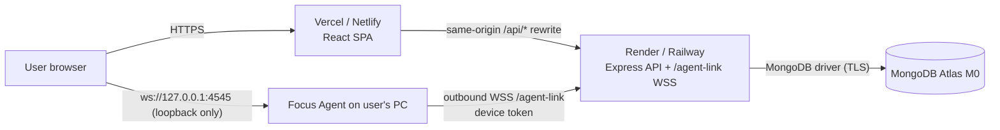

# DEPLOYMENT.md — deployment runbook (dashboard, API, database, agent)

> **Owner:** A1 (docs) · **Tasks:** T-120 (API), T-121 (dashboard), T-122 (agent links) · **Status:** **DRAFT — nothing here has been executed yet.** No live deployment exists. The blueprint's deployable target is `[PDF §19]` "live deployment (or flawless local setup)"; this runbook is the W9 recipe and is blocked on human accounts (**BL-07**).
> **Verified locally:** the app runs end-to-end on one machine (README §5), CI is green on Ubuntu/Windows/macOS, and the release workflow has produced real unsigned installers (run `42858934575`). **Not verified:** hosting providers, Atlas, public URLs, TLS, WSS from a hosted dashboard. Treat every provider-specific number below as "check at deploy time" — hosting policies change.
> **Sibling docs:** [`README.md`](../README.md) (local setup), [`docs/RELEASING.md`](RELEASING.md) (installers/signing), [`docs/PLATFORMS.md`](PLATFORMS.md) (OS + browser behaviour), [`docs/DECISIONS.md`](DECISIONS.md), blueprint `TECHNICAL_DESIGN.md` §16/§17, blueprint `docs/ARCHITECTURE_DIAGRAMS.md` §8.

## 1. Target topology



Three processes, three hosts: **dashboard** (static SPA), **API** (Node + WebSocket + in-process cron), **MongoDB** (Atlas). The Focus Agent is **not** hosted — it is installed on the user's machine and talks to the API over outbound WSS; browser↔agent traffic never leaves the machine.

Why the API is not on Vercel/Netlify serverless: the API holds a **long-lived WebSocket** (`/agent-link`, 15 s heartbeats, 45 s timeout) and runs an in-process **once-a-minute cron** scheduler — both fit a persistent Node process (Render/Railway), not short-lived functions.

## 2. Prerequisites — the human-only parts

| Item | Why only a human can do it | Needed by |
|---|---|---|
| Vercel **or** Netlify account + access to the GitHub repo | deploy target for the dashboard | T-121 |
| Render **or** Railway account + repo access | deploy target for the API (must support WebSockets) | T-120 |
| MongoDB Atlas account and a **cluster URI with password** | `MONGO_URI` is a secret | T-120 |
| GitHub repo write/admin + ability to push a `v*` tag | releases are maintainer-tagged (`docs/RELEASING.md`) | T-128 |
| Domain / DNS (optional) | vanity URL + stable `CLIENT_URL` / agent origin | T-121 |
| Decision on signing certificates (optional) | unsigned builds are documented; signing needs paid certs | W8 |

Everything below needed from the human is also listed in **§11 NEEDS-HUMAN**.

## 3. MongoDB Atlas M0

1. Create an **M0 free cluster** (one region near the API host to keep p95 low). M0 limits: shared tier, ~512 MB storage, no continuous/point-in-time backups — see §8 rollback for the honest consequence.
2. **Database access** → add a dedicated user with **readWrite on the `focus-mode` database only** (not `atlasAdmin`): e.g. user `focus-mode-app`, auth `SCRAM-SHA-256`.
3. **Network access** → allow-list the API host's egress IPs if the provider offers static egress; otherwise (Render/Railway free tiers use shared, changing egress) temporarily allow `0.0.0.0/0` **for the exam demo** and document the trade-off. Tighten before any non-demo exposure.
4. Copy the connection string and append the database name: `mongodb+srv://focus-mode-app:<password>@<cluster>.mongodb.net/focus-mode?retryWrites=true&w=majority`.
5. Verify reachability from a trusted machine:
   ```sh
   # requires mongosh / MongoDB Database Tools on the operator machine (NEEDS-HUMAN if absent)
   mongosh "mongodb+srv://focus-mode-app:<password>@<cluster>.mongodb.net/focus-mode" --eval 'db.runCommand({ ping: 1 })'
   ```

## 4. API on Render (or Railway)

The API needs: persistent process, WebSocket support, Node 22, one open port from `PORT`, and in-process cron. Render supports native WebSockets; Railway does too. Neither file below is in the repo yet — **A0/A10 place them** after review (the repo root currently has no `render.yaml`/`vercel.json`).

`render.yaml` sketch (for A0/A10 to place at the repo root; `sync: false` = set in the Render dashboard, never committed):

```yaml
services:
  - type: web
    name: focus-mode-api
    runtime: node
    plan: starter            # "free" spins down after idle and skips cron ticks — see §4.2
    region: oregon
    rootDir: .
    buildCommand: npm ci && npm run build -w @focus-mode/shared && npm run build -w @focus-mode/server
    startCommand: npm run start -w @focus-mode/server
    healthCheckPath: /health
    autoDeploy: true
    envVars:
      - key: NODE_VERSION
        value: "22"
      - key: NODE_ENV
        value: production
      - key: MONGO_URI
        sync: false
      - key: JWT_SECRET
        sync: false
      - key: JWT_EXPIRES_IN
        value: 30m
      - key: CLIENT_URL
        sync: false
      - key: PAIR_PEPPER
        sync: false
      - key: ATTEST_PRIVATE_KEY
        sync: false
      - key: ATTEST_PUBLIC_KEY
        sync: false
      - key: SEED_ADMIN_EMAIL
        value: admin@demo.com
      - key: SEED_ADMIN_PASSWORD
        sync: false
      - key: SEED_USER_EMAIL
        value: kabir@demo.com
      - key: SEED_USER_PASSWORD
        sync: false
      - key: LOG_LEVEL
        value: info
      - key: RATE_LIMIT_AUTH_MAX
        value: "10"
```

Railway: create a service from the repo, set the same variables in the service dashboard, build `npm ci && npm run build -w @focus-mode/shared && npm run build -w @focus-mode/server`, start `npm run start -w @focus-mode/server`. Railway injects `PORT` too; the API reads it from the validated env module.

### 4.1 API environment variables (exactly the 15 in `server/.env.example`)

| Variable | Production value | Notes |
|---|---|---|
| `NODE_ENV` | `production` | enables the mandatory-secret checks |
| `PORT` | host-injected (fallback `5000`) | never hard-code in code; host sets it |
| `MONGO_URI` | Atlas URI incl. `/focus-mode` | **secret** |
| `JWT_SECRET` | `openssl rand -base64 48` | **secret**, ≥32 chars, HS256 access token (SEC-2) |
| `JWT_EXPIRES_IN` | `30m` | SEC-2 |
| `CLIENT_URL` | `https://<dashboard-host>` (comma-separated if several) | CORS allow-list **and** the origin list echoed to agents (SEC-3) |
| `PAIR_PEPPER` | `openssl rand -base64 48` | **secret**, ≥32 chars (SEC-5, DEC-014) |
| `ATTEST_PRIVATE_KEY` | single-line Ed25519 PEM with literal `\n` | **secret** (SEC-7); generation in README §5 step 3 |
| `ATTEST_PUBLIC_KEY` | matching single-line PEM | served at `GET /api/v1/agent/attest-key` |
| `SEED_ADMIN_EMAIL` | `admin@demo.com` | demo seed identity |
| `SEED_ADMIN_PASSWORD` | rotate for any public URL, then update test-credential docs | see §10 security note |
| `SEED_USER_EMAIL` | `kabir@demo.com` | demo seed identity |
| `SEED_USER_PASSWORD` | rotate for any public URL | see §10 |
| `LOG_LEVEL` | `info` | pino redacts auth/password/token fields (NFR-016) |
| `RATE_LIMIT_AUTH_MAX` | `10` | failed auth per 15 min per IP (SEC-4) |

### 4.2 Free-tier sleep vs the scheduler (honest analysis)

The scheduler is an **in-process** `node-cron` tick (`server/src/cron/scheduler.ts`). If the host sleeps the process (Render free services spin down after ~15 min idle; Railway equivalent depends on plan):

- **No tick runs ⇒ a due minute is silently skipped.** It is *not* replayed and **not** recorded as MISSED, because nothing executed to detect it. This is the honest difference from the normal "agent offline" path (which does record MISSED + notification).
- Open `/agent-link` sockets drop; devices go `DISCONNECTED` after the 45 s heartbeat timeout; agents reconnect with backoff.
- The first request after sleep pays a cold-start penalty (seconds).

Mitigations, cheapest first:
1. **Use an always-on/starter tier for the demo week** (recommended for W9 evidence). This is the only mitigation that fully removes the problem.
2. **External keep-alive ping** to `https://<api-host>/health` every 5–10 minutes (a free uptime-monitor service or a GitHub Actions scheduled workflow). This keeps the process warm and the scheduler ticking, at the cost of a small always-on request pattern. It does **not** protect against a host that ignores traffic-based wake logic; re-check the provider's current policy at deploy time.
3. **Accept the limitation** for a demo: wake the API a few minutes before showing schedules, or rely on the manual Start Focus flow (schedules are P1; the P0 demo does not need them).

Additional consequence: the agent heartbeat (15 s during a session) keeps the API warm **during** a session, but not before it starts — a schedule that fires after long idle on a free tier can be missed silently. Document this in the deployed README/known limitations at W9.

## 5. Dashboard on Vercel (or Netlify)

The dashboard is a static Vite SPA that calls the API **same-origin** at `/api/v1`. The same-origin rewrite keeps the Bearer-token/session-storage model working without third-party cookies (the P2 refresh-cookie ideas in `TECHNICAL_DESIGN` §5.2 stay unnecessary) and avoids CORS in the browser.

`vercel.json` content to place at the repo root (not present yet — **A0/A10 to place**; `test-browser` note: with the repo-root directory Vercel cannot infer the client output, so the build settings are explicit):

```json
{
  "installCommand": "npm ci",
  "buildCommand": "npm run build -w @focus-mode/shared && npm run build -w @focus-mode/client",
  "outputDirectory": "client/dist",
  "rewrites": [
    { "source": "/api/:path*", "destination": "https://<api-host>/api/:path*" },
    { "source": "/:path*", "destination": "/index.html" }
  ]
}
```

Rules: both `source` patterns are ordered — the `/api/:path*` rule **must** stay first; the second rule is the SPA fallback (deep links like `/focus` must return `index.html`). Replace `https://<api-host>` with the real Render/Railway URL.

Vercel project settings: **Root Directory = repository root**, framework preset "Vite" (or Other with the commands above), Node 22. Netlify alternative: same semantics with `netlify.toml`:

```toml
[build]
  command = "npm run build -w @focus-mode/shared && npm run build -w @focus-mode/client"
  publish = "client/dist"

[[redirects]]
  from = "/api/*"
  to = "https://<api-host>/api/:splat"
  status = 200
  force = true

[[redirects]]
  from = "/*"
  to = "/index.html"
  status = 200
```

### 5.1 Dashboard environment variables (3, from `client/.env.example`)

| Variable | Production value | Notes |
|---|---|---|
| `VITE_API_BASE_URL` | `/api/v1` | relative on purpose: same-origin rewrite; dev uses `http://localhost:5000/api/v1` (DEC-013) |
| `VITE_AGENT_PORT` | `4545` | loopback port the browser scans for the Focus Agent |
| `VITE_AGENT_PORT_RANGE` | `5` | scans 4545–4549 |

`VITE_*` values are inlined into the public bundle at build time — **never put a secret in them**.

### 5.2 Focus Agent → deployed API (packaged builds)

A packaged Focus Agent does **not** read `agent/.env` (dotenv is loaded only when `app.isPackaged === false`, DEC-013). To pair against the deployed API it needs these process env vars at launch:

| Variable | Production value |
|---|---|
| `AGENT_API_BASE_URL` | `https://<api-host>/api/v1` (must include `/api/v1`) |
| `AGENT_ALLOWED_ORIGINS` | `https://<dashboard-host>` (exactly the dashboard origin, no wildcard) |
| `AGENT_FOCUS_DRIVER` | `real` (packaged builds reject `fake`) |
| `AGENT_PORT` | `4545` (default; falls back 4546–4549 if busy) |
| `AGENT_LOG_LEVEL` | `info` |

Honest limitation: the current installer has **no first-run settings UI for these two URLs**, so for the W9 demo launch the agent from a terminal with the variables exported, or set them at the OS level. Baking a configurable API origin into the packaged app is a post-exam enhancement (documented, not hidden).

## 6. Cross-service wiring (the 3 things people get wrong)

1. `CLIENT_URL` on the API must be the **dashboard's deployed origin** (`https://<dashboard-host>`), not the API host — it drives CORS and the origin list echoed to agents.
2. `AGENT_ALLOWED_ORIGINS` in the agent must be the **dashboard's deployed origin** — otherwise the loopback WS upgrade is rejected and the badge stays "Not paired".
3. `AGENT_API_BASE_URL` must include **`/api/v1`** — the API base convention is full-base everywhere (DEC-013).

Then: `GET /api/v1/agent-links` (public) should return installer links; after the first maintainer-pushed `v*` tag creates the draft GitHub Release, an admin points `agentLinks` at the release assets (T-122, `docs/RELEASING.md`).

## 7. Seed the deployed database

The seed is idempotent and refuses `NODE_ENV=production` without `--force` (the demo passwords are public). Run it from a trusted machine that has the repo dependencies installed and a complete `server/.env` (the validated env module needs `JWT_SECRET` etc. even for seeding), overriding only the URI:

```sh
cd Focus-Mode
MONGO_URI='mongodb+srv://focus-mode-app:<password>@<cluster>.mongodb.net/focus-mode?retryWrites=true&w=majority' \
  npm run seed
```

If your `server/.env` sets `NODE_ENV=production`, pass the explicit flag through the workspace script — only for an intentional, disposable demo database (note the `--` before the flag; npm forwards it to the seed CLI):

```sh
MONGO_URI='...' npm run seed --workspace @focus-mode/server -- --force
```

The seed prints the demo logins (also in README §6). Re-running it is safe (same counts, no duplicates).

## 8. Post-deploy smoke checks

Run these in order; record the output in `docs/QA_REPORT.md` at W9. `/health` is process liveness; `/health/db` is readiness (503 while Mongo is not connected).

```sh
API=https://<api-host>
DASH=https://<dashboard-host>

# 1. API liveness + readiness (expect the standard success envelope)
curl -sS "$API/health"
curl -sS "$API/health/db"

# 2. Same-origin rewrite: this must hit the API *through the dashboard origin*
curl -sS "$DASH/api/v1/health"

# 3. Auth: demo user login returns an access token
curl -sS -X POST "$API/api/v1/auth/login" \
  -H 'content-type: application/json' \
  -d '{"email":"kabir@demo.com","password":"Kabir@123"}'
#    wrong password must be 401 UNAUTHENTICATED; 11 bad logins from one IP must hit 429
```

Then the browser + agent checks (manual):

4. Open `$DASH`, log in as `kabir@demo.com / Kabir@123`; landing → login → dashboard renders; no CORS errors in DevTools (all API calls go to the dashboard origin).
5. `/insights` and `/notifications` load seeded data; `/admin` as `admin@demo.com` shows users/deactivate + aggregate stats; as the USER account `/admin` shows the 403 page.
6. **Pairing**: export `AGENT_API_BASE_URL=https://<api-host>/api/v1` and `AGENT_ALLOWED_ORIGINS=https://<dashboard-host>`, launch the Focus Agent, type its 6-digit code on `/devices` → badge becomes **Connected without a reload** (KI-010 fix), device row appears.
7. **Focus on a real desktop** (the only step that proves FOCUS-1/2): start a 1-minute custom session, confirm the consent modal, see other windows step aside (browser stays), watch the countdown, end from the dashboard (or let the timer expire) → windows restore, session appears in `/dashboard` recent + `/insights`.
8. **Pickup when the dashboard is closed**: start a session, close the browser tab, end from the agent window/tray → session still persisted exactly once (FR-027, verified by E2E).
9. **Scheduler**: create a schedule due in ~2 minutes, keep the API awake (§4.2), stay online with the agent → native heads-up ≥10 s; cancel once (run `CANCELLED_BY_USER`) and let it start once (`source SCHEDULE`). With the agent offline → run `MISSED` + notification (only if the API is awake at the due minute).
10. **WSS**: agent log/DevTools shows `/agent-link` connected; device status flips to `DISCONNECTED` within ~45 s after quitting the agent.
11. **No secrets in the bundle**: search the deployed JS for `JWT_SECRET`, `MONGO_URI`, `PAIR_PEPPER`, `PRIVATE KEY` — none must appear.

## 9. Rollback

| Layer | Rollback action | Notes |
|---|---|---|
| Dashboard (Vercel) | Deployments → previous successful deployment → **Promote to Production** (instant, no rebuild) | Also revert the git change; promote from a known-good commit |
| Dashboard (Netlify) | Deploys → previous deploy → **Publish deploy** | same |
| API (Render) | Dashboard → the service → **Rollback** to a previous deploy (or redeploy an earlier commit) | Keep API and dashboard compatible; contract changes follow AGENTS §5 |
| API (Railway) | Deployments → previous deployment → **Redeploy** | same |
| Database | **M0 has no automated backups.** Take a `mongodump` immediately before the demo (`mongodump --uri="$MONGO_URI" --out=backup-$(date +%F)`) if the tools are available; otherwise the recovery path is **re-seed** (idempotent) or a fresh database | There are no migrations; schema changes are additive, but roll the API back rather than the DB alone |
| Agent release | Never rewrite a published tag: fix forward with a new patch tag (`docs/RELEASING.md` §7) | release job is tag-only by design |

Post-rollback: re-run §8 checks 1–3 and one login; state honestly in `docs/QA_REPORT.md` what was rolled back and why.

## 10. Security notes for a deployed instance

- HTTPS/WSS only; the API validates `CLIENT_URL` origins for CORS (SEC-3) and the agent pins `AGENT_ALLOWED_ORIGINS` (NFR-010).
- Secrets live only in host dashboards (Render/Railway/Vercel env settings), never in the repo; CI runs a gitleaks scan (contribution rules in `AGENTS.md` §7, release rules in `docs/RELEASING.md` §5).
- The seeded demo passwords (`Admin@123` / `Kabir@123`) are public in the README by design for the exam. **For any public URL**: keep the deployment unlisted/private for the demo, or rotate `SEED_*` passwords (and update the test-credential docs) — never expose a public admin account with a known password.
- Atlas: dedicated least-privilege user; tighten network access after the demo; M0 has no backups (see §9).
- `ATTEST_PRIVATE_KEY` must be unique per environment — never reuse the local dev key in production; the agent verifies with `GET /agent/attest-key`, so rotating both keys together is safe.

## 11. NEEDS-HUMAN — deployment register (precise)

| # | Item | Owner | Blocking |
|---|---|---|---|
| DH-1 | Create/choose hosting accounts (Vercel **or** Netlify; Render **or** Railway) and grant repo access | Human | T-120/T-121 |
| DH-2 | Create the Atlas M0 cluster + least-privilege DB user; supply the `MONGO_URI` (secret) and confirm the IP allow-list policy | Human | T-120 |
| DH-3 | Generate and store production secrets (`JWT_SECRET`, `PAIR_PEPPER`, Ed25519 keypair) in the host dashboards | A0 + Human | T-120 |
| DH-4 | Decide + set `CLIENT_URL` (deployed dashboard origin) and `AGENT_ALLOWED_ORIGINS` (same origin) | A0 | §6 |
| DH-5 | Approve placing `vercel.json` / `render.yaml` (this doc contains the content; root files are A0/A10-owned) | A0/A10 | T-120/T-121 |
| DH-6 | Run the seed against Atlas (§7) and record the resulting counts | A0 | T-120 |
| DH-7 | Execute the browser + pairing + scheduler smoke checks (§8 items 4–10) on a real desktop | Human/A7 | T-101/T-120 |
| DH-8 | Decide the demo-credential policy for a public URL (unlisted vs rotate) | Human/A0 | §10 |
| DH-9 | Push the first `v*` tag so a GitHub Release exists, then point admin `agentLinks` at the assets | Human/A0 | T-122/T-128 |
| DH-10 | Update README + this doc with the final URLs only **after** they exist (never invent links) | A1/A0 | W9 |
| DH-11 | Optional: domain/DNS + signing certificates | Human | W8 |

## 12. Honest local fallback (if hosting is unavailable at W9)

`[PDF §19]` accepts **"live deployment **or** flawless local setup"**. If accounts/credentials are still missing at the W9 gate, present the local path and say so plainly:

```sh
# full product, one machine (README §5): API :5000 + dashboard :5173 + Focus Agent
npm install
npm run build -w @focus-mode/shared
cp server/.env.example server/.env && cp client/.env.example client/.env && cp agent/.env.example agent/.env
#  …fill server/.env with generated JWT_SECRET / PAIR_PEPPER / Ed25519 keys (README §5 step 3)
npm run seed
npm run dev
```

Credentials-free proof path (real dashboard + real API + real Electron agent, no hosting, no Atlas — the E2E harness starts an in-memory MongoDB and seeds it):

```sh
npm run build -w @focus-mode/shared && npm run build -w @focus-mode/agent
PLAYWRIGHT_BROWSERS_PATH=$PWD/.playwright-browsers npx playwright install chromium
PLAYWRIGHT_BROWSERS_PATH=$PWD/.playwright-browsers npx playwright test   # 27/27 at the W5 gate
```

What the local fallback cannot demonstrate: a public URL, TLS/WSS from a remote origin, and hosted scheduler timing. Say that explicitly in the demo/viva instead of implying a deployment exists.
